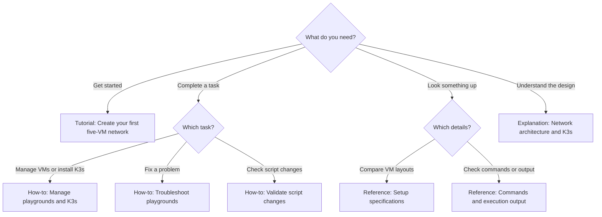

# Playground documentation

Documentation follows Diátaxis, separating learning, practical tasks, technical reference, and explanation.

Start with the tutorial if this is your first visit. Otherwise, follow the branch that matches your goal. Click a document in the diagram to open it, or use the links in the table below.

| Section | Purpose | Start here |
| --- | --- | --- |
| Tutorials | Learn by completing a guided exercise | [Create your first five-VM network](tutorials/first-playground.md) |
| How-to guides | Complete a specific task | [Manage playgrounds and K3s](how-to/manage-playgrounds.md), [troubleshoot](how-to/troubleshoot.md), [validate scripts](how-to/validate-scripts.md) |
| Reference | Look up specifications and command behavior | [Setups](reference/setups.md), [commands and execution output](reference/commands.md) |
| Explanation | Understand the design | [Network architecture and K3s](explanation/architecture.md) |

Both setups manage the playground titles `node-01` through `node-05`. Use one setup at a time per account.
